# Практична робота № 5
## Тема: Розробка REST-сервісу на базі фреймворку Gin та СУБД PostgreSQL
### (Реалізація: Рівень 1 та Рівень 2)

---

## Зміст
1. [Мета роботи](#мета-роботи)
2. [Опис реалізованої системи (Рівні 1 та 2)](#опис-реалізованої-системи-рівні-1-та-2)
3. [Структура проєкту](#структура-проєкту)
4. [Опис REST API](#опис-rest-api)
5. [Покрокова інструкція із запуску](#покрокова-інструкція-із-запуску)
6. [Скріншоти роботи програми](#скріншоти-роботи-програми)
7. [Відповіді на контрольні питання](#відповіді-на-контрольні-питання)
8. [Висновок](#висновок)

---

## Мета роботи
- Опанувати розробку вебсервісів на фреймворку Gin (`gin-gonic/gin`) та роботу з контекстом запиту `gin.Context`.
- Навчитися застосовувати декларативну валідацію DTO за допомогою тегів `binding` (`go-playground/validator`).
- Опанувати підключення до PostgreSQL, проєктування моделей та операції через ORM GORM.
- Засвоїти хешування паролів алгоритмом `bcrypt` та випуск підписаних JWT-токенів (`golang-jwt/jwt/v5`).

---

## Опис реалізованої системи (Рівні 1 та 2)

Розроблено бекенд-сервіс **обліку технічних інцидентів (Incident Tracker API)** на Gin + GORM + PostgreSQL.

1. **Рівень 1 (Базовий: Gin, PostgreSQL, валідація DTO)**:
   - Ініціалізовано Go-модуль `pr5_minenko`, встановлено `gin`, `gorm`, `gorm.io/driver/postgres`.
   - Пакет `internal/database`: функція `Connect()` відкриває з'єднання через GORM, налаштовує пул з'єднань і **перевіряє його запитом `Ping()`**; функція `Migrate()` виконує `AutoMigrate` для моделей.
   - Модель `Incident` (`id`, `title`, `description`, `priority`, `status` зі значенням за замовчуванням `open`, `created_at`).
   - `CreateIncidentDTO` з тегами валідації: `title` — `required,min=3,max=100`; `description` — `required`; `priority` — `required,oneof=low medium high critical`.
   - `POST /api/v1/incidents` — `ShouldBindJSON`, при помилці `400 Bad Request` з **детальним переліком некоректних полів** (імена полів беруться з `json`-тегів), при успіху — запис у PostgreSQL і `201 Created`.
   - `GET /api/v1/incidents` — `db.Find(&incidents)`, `200 OK` (порожня таблиця повертає `[]`, а не `null`).

2. **Рівень 2 (Ключовий: повний CRUD та автентифікація)**:
   - `GET /api/v1/incidents/:id` — `db.First(&incident, id)`, `200 OK` або `404 Not Found`; нечисловий `id` — `400`.
   - `PATCH /api/v1/incidents/:id/status` — `UpdateStatusDTO` з `binding:"required,oneof=open in_progress resolved closed"`, повертає актуальний стан.
   - `DELETE /api/v1/incidents/:id` — `204 No Content` (без тіла) або `404`, якщо запису немає (`RowsAffected == 0`).
   - Модель `User` (`email` з `uniqueIndex`, `PasswordHash` з тегом `json:"-"` — ніколи не потрапляє у відповідь).
   - `POST /api/v1/auth/register` — валідація (`email`, пароль 6..72 символи), `bcrypt.GenerateFromPassword`, `201 Created`; повторний email — `409 Conflict` (через `gorm.ErrDuplicatedKey`, `TranslateError: true`).
   - `POST /api/v1/auth/login` — пошук за email, `bcrypt.CompareHashAndPassword`, при невідповідності `401 Unauthorized`, при успіху JWT (HS256, термін дії 24 год) у форматі `{"token": "..."}`.
   - Додатково: email нормалізується (нижній регістр), при неіснуючому email bcrypt виконується з фіктивним гешем (час відповіді не видає, чи зареєстрований email), у лог GORM не потрапляють значення параметрів SQL (геші паролів), час зберігається в UTC.
   - Написано автоматичні тести (`internal/handler/handler_test.go`) на in-memory SQLite (pure Go), що перевіряють CRUD, валідацію, реєстрацію та вхід без запущеного PostgreSQL.

---

## Структура проєкту

```text
PR5_Minenko/
├── internal/
│   ├── config/config.go       # Налаштування зі змінних оточення (порт, БД, JWT)
│   ├── database/database.go   # Підключення GORM + Ping, пул з'єднань, AutoMigrate
│   ├── model/model.go         # GORM-моделі Incident та User
│   ├── dto/dto.go             # Вхідні DTO з тегами binding
│   ├── auth/jwt.go            # Генерація та перевірка JWT (HS256)
│   └── handler/
│       ├── routes.go          # Gin-роутер, група /api/v1
│       ├── incident.go        # CRUD-обробники інцидентів
│       ├── auth.go            # Реєстрація та вхід (bcrypt + JWT)
│       ├── errors.go          # Форматування помилок валідації
│       └── handler_test.go    # Автоматичні тести
├── png/                       # Скріншоти для звіту
├── main.go                    # Точка входу
├── requests.http              # Набір запитів для VS Code REST Client
├── go.mod / go.sum
└── README.md
```

---

## Опис REST API

| Метод | Шлях | Опис | Успіх | Помилки |
|-------|------|------|-------|---------|
| `POST` | `/api/v1/auth/register` | Реєстрація інженера | `201 Created` | `400`, `409 Conflict` |
| `POST` | `/api/v1/auth/login` | Вхід, отримання JWT | `200 OK` | `400`, `401 Unauthorized` |
| `GET` | `/api/v1/incidents` | Список інцидентів | `200 OK` | — |
| `POST` | `/api/v1/incidents` | Створення інциденту | `201 Created` | `400 Bad Request` |
| `GET` | `/api/v1/incidents/:id` | Інцидент за ID | `200 OK` | `400`, `404 Not Found` |
| `PATCH` | `/api/v1/incidents/:id/status` | Зміна статусу | `200 OK` | `400`, `404` |
| `DELETE` | `/api/v1/incidents/:id` | Видалення | `204 No Content` | `400`, `404` |

**Формат помилки валідації:**
```json
{"error":"validation failed","fields":{"priority":"must be one of: low medium high critical (got 'urgent')"}}
```

**Змінні оточення** (усі мають значення за замовчуванням для локального запуску):

| Змінна | За замовчуванням |
|--------|------------------|
| `HTTP_PORT` | `8080` |
| `DB_HOST` / `DB_PORT` | `localhost` / `5432` |
| `DB_USER` / `DB_PASSWORD` / `DB_NAME` | `postgres` / `postgres` / `postgres` |
| `JWT_SECRET` | `dev-secret-change-me` |

---

## Покрокова інструкція із запуску

### Крок 1. Запуск PostgreSQL у Docker
```powershell
docker run -d --name postgres-dev -e POSTGRES_PASSWORD=postgres -p 5432:5432 postgres:alpine
```
Якщо контейнер уже існує: `docker start postgres-dev`.

### Крок 2. Встановлення залежностей та запуск сервера (Термінал № 1)
```powershell
go mod download
go run .
```
Очікуваний вивід:
```text
[GORM] Connected to PostgreSQL successfully (host=localhost:5432, db=postgres)
[GORM] Auto-migration completed: 'users', 'incidents' tables are up to date.
[GIN-debug] POST   /api/v1/auth/register     --> ...RegisterHandler-fm (3 handlers)
[GIN-debug] POST   /api/v1/auth/login        --> ...LoginHandler-fm (3 handlers)
[GIN-debug] GET    /api/v1/incidents         --> ...ListIncidentsHandler-fm (3 handlers)
[GIN-debug] POST   /api/v1/incidents         --> ...CreateIncidentHandler-fm (3 handlers)
...
[СЕРВЕР] Сервіс успішно запущено на http://localhost:8080
```

### Крок 3. Перевірка ендпоінтів (Термінал № 2)

> У PowerShell використовуйте `curl.exe` (а не `curl`, який є псевдонімом `Invoke-WebRequest`). Найпростіше — виконати команди в Git Bash або через файл `requests.http` (розширення REST Client).

**Створення інциденту (201):**
```bash
curl -i -X POST http://localhost:8080/api/v1/incidents \
  -H "Content-Type: application/json" \
  -d '{"title":"Overheating on Gateway-01","description":"Core temperature reached 85C","priority":"critical"}'
```
**Невалідний пріоритет (400):**
```bash
curl -i -X POST http://localhost:8080/api/v1/incidents \
  -H "Content-Type: application/json" \
  -d '{"title":"Disk failure","description":"RAID degraded","priority":"urgent"}'
```
**Список та інцидент за ID (200 / 404):**
```bash
curl -i http://localhost:8080/api/v1/incidents
curl -i http://localhost:8080/api/v1/incidents/1
curl -i http://localhost:8080/api/v1/incidents/999
```
**Зміна статусу (200):**
```bash
curl -i -X PATCH http://localhost:8080/api/v1/incidents/1/status \
  -H "Content-Type: application/json" -d '{"status":"in_progress"}'
```
**Видалення (204):**
```bash
curl -i -X DELETE http://localhost:8080/api/v1/incidents/1
```
**Реєстрація та вхід:**
```bash
curl -i -X POST http://localhost:8080/api/v1/auth/register \
  -H "Content-Type: application/json" \
  -d '{"email":"engineer@company.internal","password":"SuperSecretPassword123"}'

curl -i -X POST http://localhost:8080/api/v1/auth/login \
  -H "Content-Type: application/json" \
  -d '{"email":"engineer@company.internal","password":"SuperSecretPassword123"}'
```

### Крок 4. Перевірка даних у PostgreSQL
```powershell
docker exec -it postgres-dev psql -U postgres
```
```sql
\dt
SELECT id, email, left(password_hash, 29) AS password_hash, created_at FROM users;
SELECT id, title, priority, status, created_at FROM incidents;
```

### Крок 5. Автоматичні тести
```powershell
go vet ./...
go test -v ./...
```
Тести використовують in-memory SQLite, тому PostgreSQL для них не потрібен.

---

## Скріншоти роботи програми

| № | Файл | Що показано |
|---|------|-------------|
| 1 | `1_server_start.png` | Підключення до PostgreSQL, авто-міграція, таблиця маршрутів Gin |
| 2 | `2_create_incident.png` | `POST /incidents` → `201 Created` |
| 3 | `3_validation_400.png` | Невалідний `priority: "urgent"` та порожні поля → `400` з переліком полів |
| 4 | `4_list_incidents.png` | `GET /incidents` → `200 OK` |
| 5 | `5_get_by_id_and_404.png` | `GET /incidents/1` → `200`, `GET /incidents/999` → `404` |
| 6 | `6_patch_status.png` | `PATCH /status` → `200`, невалідний статус → `400` |
| 7 | `7_delete_and_404.png` | `DELETE` → `204 No Content`, повторний `GET` → `404` |
| 8 | `8_register.png` | Реєстрація `201`, повторна `409`, невалідні дані `400` |
| 9 | `9_login_jwt.png` | Вхід `200` + JWT, невірний пароль `401` |
| 10 | `10_postgres_tables.png` | Таблиці в PostgreSQL, bcrypt-геш у полі `password_hash` |
| 11 | `11_server_logs.png` | Журнал запитів Gin |
| 12 | `12_go_test_passed.png` | `go vet` та `go test -v` без помилок |

#### 1. Запуск сервера
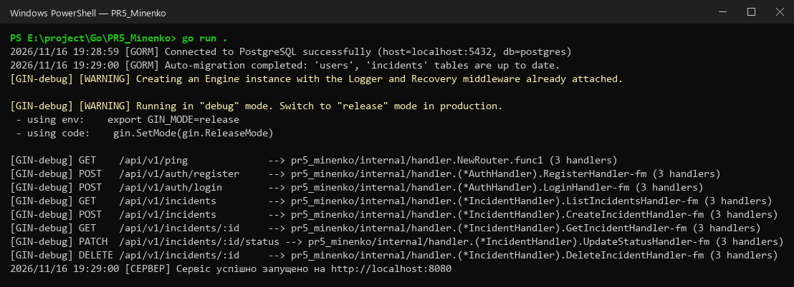

#### 2. Створення інциденту (POST → 201)
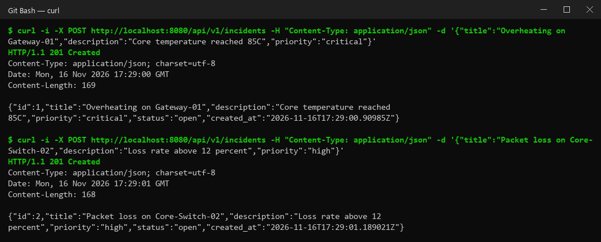

#### 3. Валідація DTO (POST → 400)
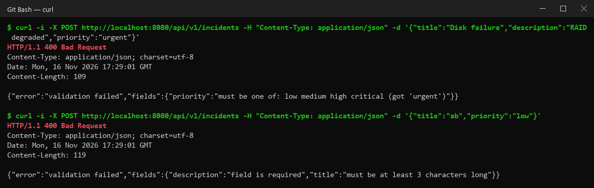

#### 4. Список інцидентів (GET → 200)
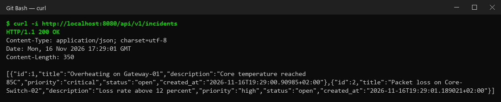

#### 5. Інцидент за ID (GET → 200 / 404)
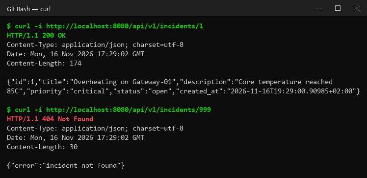

#### 6. Зміна статусу (PATCH → 200 / 400)
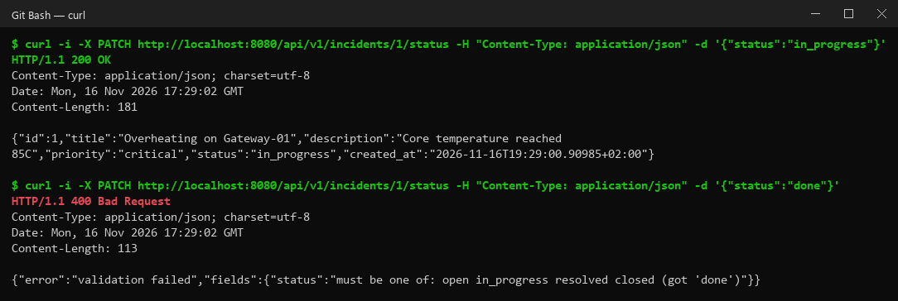

#### 7. Видалення (DELETE → 204, GET → 404)
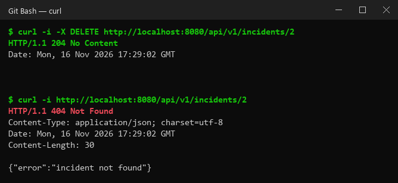

#### 8. Реєстрація (201 / 409 / 400)
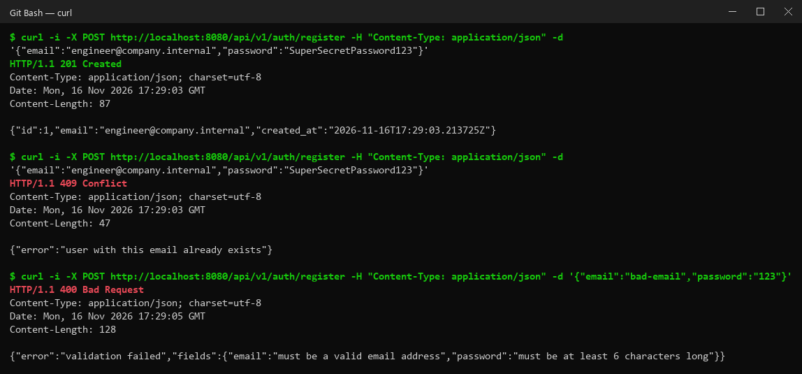

#### 9. Вхід та отримання JWT (200 / 401)
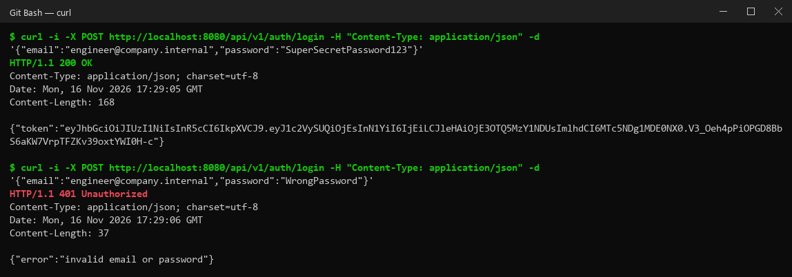

#### 10. Дані в PostgreSQL
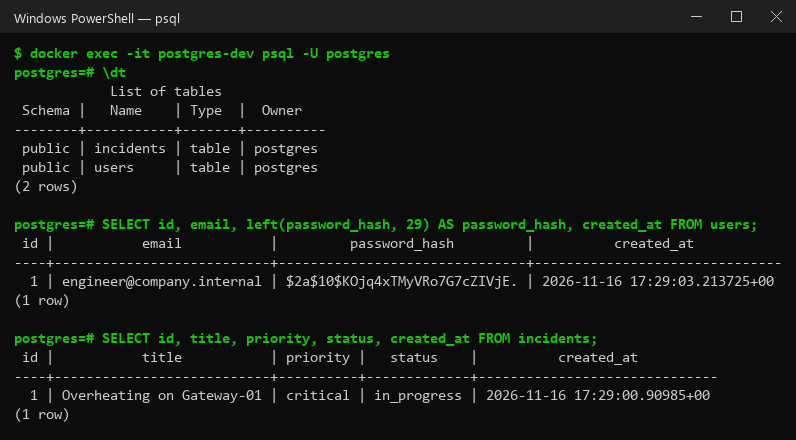

#### 11. Журнал сервера
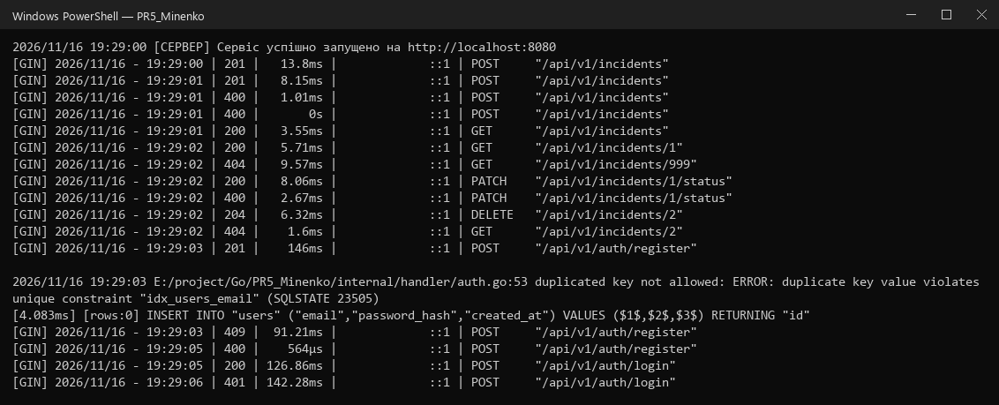

#### 12. Автоматичні тести
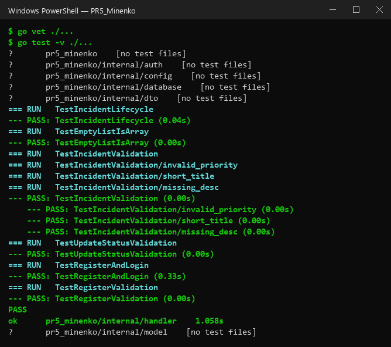

---

## Відповіді на контрольні питання

### 1. Головні архітектурні відмінності між Gin та Chi
**Chi** — легкий маршрутизатор, повністю сумісний з `net/http`: обробники мають стандартну сигнатуру `func(w http.ResponseWriter, r *http.Request)`, а Middleware — `func(http.Handler) http.Handler`. Усе інше (JSON, валідація, зв'язування) розробник робить сам або бере окремими бібліотеками.
**Gin** — повноцінний фреймворк із власним типом обробника `func(c *gin.Context)`. `gin.Context` об'єднує запит, відповідь, параметри шляху, зв'язування й валідацію (`ShouldBindJSON`), рендеринг (`c.JSON`), сховище значень (`c.Set/Get`) та керування ланцюжком (`c.Next`, `c.Abort`). Обидва використовують radix-дерево маршрутів, але Gin додатково оптимізований під мінімум алокацій (пул контекстів). Ціна — менша сумісність зі стандартною екосистемою `net/http` Middleware.

### 2. Як `gin.Context` зменшує навантаження на GC за допомогою пулу об'єктів
Gin зберігає об'єкти `Context` у `sync.Pool`. На кожен запит рушій бере готовий контекст з пулу (`engine.pool.Get()`), скидає його поля (`c.reset()`) і передає обробникам, а після завершення запиту повертає в пул (`engine.pool.Put(c)`). Таким чином контексти не створюються заново для кожного запиту, кількість алокацій у купі та робота збирача сміття різко зменшуються. Наслідок: не можна зберігати `*gin.Context` і використовувати його в горутині після завершення обробника — для цього є `c.Copy()`.

### 3. `c.ShouldBindJSON` та відмінність від `c.BindJSON`
Обидва методи десеріалізують тіло JSON у структуру й запускають валідатор за тегами `binding`. Різниця в обробці помилки:
- `ShouldBindJSON` лише **повертає помилку** — розробник сам вирішує, який код і формат відповіді віддати (у проєкті — `400` з переліком полів).
- `BindJSON` (група `Must Bind`) при помилці **автоматично** викликає `c.AbortWithError(400, err)` і одразу записує статус `400` (без тіла); змінити код відповіді після цього вже не вийде (Gin виведе попередження `[WARNING] Headers were already written`).
Тому для контрольованого формату помилок рекомендовано `ShouldBind*`.

### 4. Переваги GORM порівняно з `database/sql`
- Відображення рядків таблиць у структури без ручного `rows.Scan` для кожного поля.
- Автоматичне формування **параметризованих** запитів (захист від SQL-ін'єкцій) через ланцюжки `Where`, `First`, `Find`, `Update`.
- `AutoMigrate` — створення та оновлення схеми з опису моделей (індекси, обмеження, значення за замовчуванням).
- Автоматичне заповнення `CreatedAt`/`UpdatedAt`, м'яке видалення, асоціації, хуки, транзакції (`db.Transaction`).
- Переносимість між СУБД (PostgreSQL, MySQL, SQLite) — у проєкті це використано в тестах на SQLite.
Недоліки: додаткові накладні витрати на рефлексію та менший контроль над SQL; для складних запитів доступні `Raw` / `Exec`.

### 5. Чому не можна гешувати паролі MD5/SHA-256 і чому bcrypt — стандарт
MD5 і SHA-256 — **швидкі** геш-функції: GPU обчислює мільярди гешів на секунду, тому після витоку бази паролі підбираються перебором за словником. Без солі однакові паролі дають однакові геші й зламуються райдужними таблицями.
**bcrypt** спеціально спроєктований бути повільним: параметр вартості (`cost`, за замовчуванням 10 → 2^10 раундів) можна збільшувати разом із ростом потужності обладнання. Кожен геш містить випадкову 128-бітну **сіль**, тому однакові паролі мають різні геші, а райдужні таблиці марні. Формат `$2a$10$<сіль><геш>` зберігає алгоритм, вартість і сіль разом, тож `CompareHashAndPassword` не потребує додаткових даних.

### 6. Структура JWT та перевірка цілісності без звернення до БД
Токен — три частини в Base64URL, розділені крапками:
1. **Header** — алгоритм і тип: `{"alg":"HS256","typ":"JWT"}`;
2. **Payload** — claims: `{"userID":1,"sub":"1","exp":...,"iat":...}`;
3. **Signature** — `HMACSHA256(base64(header) + "." + base64(payload), secret)`.
Сервер, отримавши токен, сам обчислює підпис від перших двох частин своїм секретним ключем і порівнює з третьою. Будь-яка зміна payload (наприклад, `userID`) робить підпис невалідним, а підробити підпис без секрету неможливо. Також перевіряється `exp`. Уся перевірка — суто обчислювальна, тому база даних не потрібна (stateless). Payload не шифрується, тому секретні дані в нього класти не можна.

### 7. Як `c.AbortWithStatusJSON()` у Middleware перериває ланцюжок
Gin зберігає обробники маршруту як масив `HandlersChain` і поточний індекс `c.index`. `c.Next()` збільшує індекс і викликає наступний обробник. `c.Abort()` встановлює індекс у спеціальне значення `abortIndex` (більше за довжину ланцюжка), тому жоден наступний обробник більше не викликається. `AbortWithStatusJSON(code, obj)` = `Abort()` + запис коду та JSON-тіла. Важливо після виклику зробити `return`, бо поточна функція сама продовжує виконуватися. (JWT Middleware належить до Рівня 3 і в цій роботі не реалізувався.)

### 8. Принцип автоматичної генерації документації `swag`
Утиліта `swag init` статично розбирає вихідний код Go (через `go/ast`), знаходить спеціальні коментарі-анотації (`@title`, `@Summary`, `@Param`, `@Success`, `@Router`, `@Security` тощо) над `main()` і над обробниками, аналізує типи структур, на які посилаються анотації (DTO, моделі), і генерує специфікацію OpenAPI 2.0 (`docs/swagger.json`, `swagger.yaml`) та Go-пакет `docs`. Бібліотека `gin-swagger` віддає цю специфікацію разом зі Swagger UI за маршрутом `/swagger/*any`. Документація живе поруч із кодом і перегенеровується однією командою. (Swagger належить до Рівня 3 і в цій роботі не реалізувався.)

---

## Висновок
Під час виконання практичної роботи № 5 (Рівні 1 та 2):
1. Побудовано REST-сервіс обліку інцидентів на фреймворку Gin з версіонованою групою маршрутів `/api/v1`.
2. Налаштовано підключення до PostgreSQL через GORM з перевіркою з'єднання, пулом з'єднань і авто-міграцією таблиць `users` та `incidents`.
3. Застосовано декларативну валідацію DTO тегами `binding` з поверненням детального переліку некоректних полів.
4. Реалізовано повний життєвий цикл інциденту: створення, читання списку та за ID, зміну статусу, видалення з коректними кодами `201/200/204/400/404`.
5. Реалізовано реєстрацію з хешуванням паролів `bcrypt` (геш прихований від серіалізації) та вхід з випуском JWT-токена (HS256, 24 год).
6. Написано автоматичні тести, що підтверджують коректність усіх сценаріїв.
